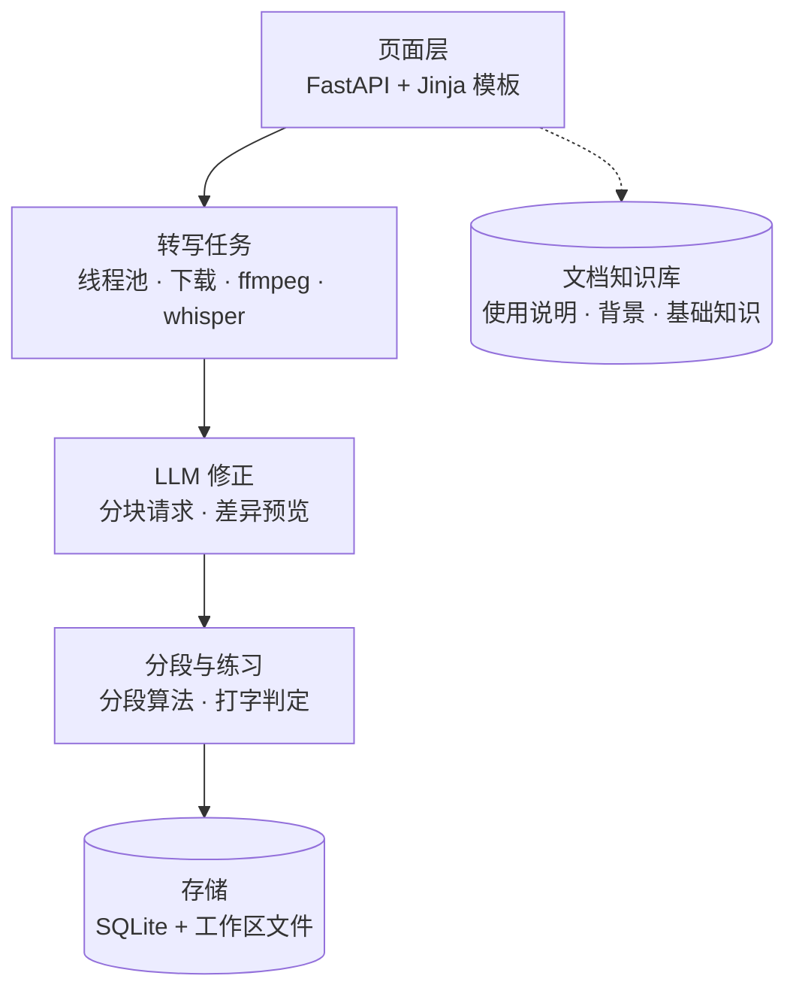

# bili2text

## 背景 / 要解决的问题

### 1.1 为什么需要视频转文字

视频本身是结构化、体系化的学习资源。但在视频形态下，内容不便快速回看、检索和引用，也很难按自己的节奏反复消化。因此先把它转成系统化的文本，作为后续修正、分段与练习的基础。

### 1.2 为什么需要引入 LLM 和打字

- 转写结果存在同音字、断句和标点错误，拿到文本后缺少低成本的修正手段，所以需要 LLM 修正。
- 逐字稿页面以「看」为主，看过一遍不等于真正过一遍；只有逐字输入、把节奏放慢，内容才会被梳理，所以需要打字练习。

### 1.3 框架图

## 需求

- **R1 链接转写**：粘贴 B 站链接提交，后台下载音频并转写，任务页实时展示阶段与进度。
- **R3 LLM 修正**：在设置页配置 OpenAI 兼容接口，手动触发；长文按 1500 字分块请求，只纠错不删减；生成差异预览，用户应用后成为新版本，可放弃；支持失败重试与取消。
- **R4 自动分段**：按句末标点切分，单段 120–300 字，超长句二次切分，尾部过短合并；各段拼接必须还原原文。
- **R5 打字练习**：按分段进入，支持多选段落与粘贴自定义文本；逐字对比，错字标红占位但不阻断输入，英文大小写不敏感，标点自动略过；统计 CPM、正确率、错误字符并留存记录。
- **R6 页面结构**：首页提交区、任务进度页、逐字稿双栏（版本切换 + 内容）、设置页、练习选择页与练习页。
- **R7 文档模块**：独立的知识库站点，记录使用说明、背景与基础知识；以集成开源知识库整站的方式提供（产品选型与同步方式【待定】）。

## 主流程

1. 首页粘贴 B 站链接，提交转写任务。
2. 任务页查看下载、转写进度，完成后进入逐字稿页。
3. 在逐字稿页按需触发 LLM 修正，等待修正任务完成。
4. 打开修正预览，查看逐字差异，应用生成 ai_corrected 版本（或放弃）。
5. 系统对激活版本自动分段；在练习选择页勾选一个或多个段落，或粘贴自定义文本。
6. 进入逐字练习，完成后查看用时、CPM、正确率、错误字符，记录留存。

## 当前状态

- 主要功能已经跑通：转写、LLM 修正、自动分段、打字练习都能正常用，服务开在 http://127.0.0.1:8000，56 项测试全部通过。
- 数据都有落库：逐字稿版本、分段、修正预览、练习记录都能存下来；拿真实视频 4 试过，激活版本切成 34 段。
- LLM 修正要先配好才生效：在设置页填上 Base URL、API Key 和模型名，没配也不影响转写、分段和练习。
- 文档站已经建好：VitePress 生成，按 `/docs/` 路径提供，内容由 sync-docs 从根目录的 PROJECT.md、LOG.md、SOP.md 同步。

### 还没解决

- 中文输入法上屏没法在自动化里模拟，打字练习的实际手感还得人工确认。
- 页面样式依赖 Tailwind CDN，断网时样式会丢。
