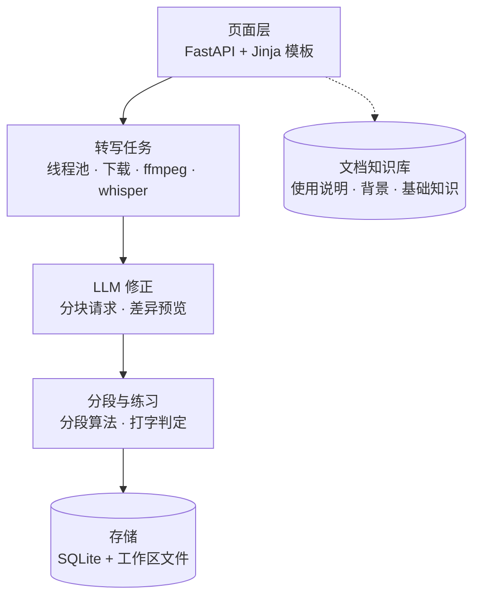

# bili2text

> 把 B 站视频转成可修正、可分段的逐字稿，并直接用于打字练习。

## 背景 / 要解决的问题

### 背景 1：为什么用打字练习

视频本身是结构化、体系化的学习资源。为了方便记忆，我们把它转成系统化的文本，再通过打字练习反复多遍输入：逐字敲一遍原文，节奏自然放慢，内容在重复中被梳理，理解也更充分。

### 背景 2：工具现状

- 现有流程能把 B 站视频转成逐字稿，但转写结果存在同音字、断句和标点错误，拿到文本后缺少低成本的修正手段。
- 逐字稿页面以「看」为主，没法把素材变成可反复练习、可量化的输入内容。

### 主线

要让「反复输入」真正发生，视频必须先变成干净、可分段、可练习的文本。因此项目主线是 **转写 → 修正 → 分段 → 打字练习**：转写解决「有没有文本」，修正解决「文本能不能读」，分段解决「一次练多少」，打字练习解决「有没有真正过一遍」。文档模块不属于这条主流程，它承载使用说明、项目背景与基础知识，供使用和查阅。

## 框架图

## 使用者

- 单用户本地部署：使用者本人在自己电脑上运行，不涉及账号、权限与多人协作。

## 需求

- **R1 链接转写**：粘贴 B 站链接提交，后台下载音频并转写，任务页实时展示阶段与进度。
- **R2 版本管理**：逐字稿分为原稿（original）、人工编辑（edited）、AI 修正（ai_corrected）；同一时间只有一个激活版本，可切换与下载。
- **R3 LLM 修正**：在设置页配置 OpenAI 兼容接口，手动触发；长文按 1500 字分块请求，只纠错不删减；生成差异预览，用户应用后成为新版本，可放弃；支持失败重试与取消。
- **R4 自动分段**：按句末标点切分，单段 120–300 字，超长句二次切分，尾部过短合并；各段拼接必须还原原文。
- **R5 打字练习**：按分段进入，支持多选段落与粘贴自定义文本；逐字对比，错字标红占位但不阻断输入，英文大小写不敏感，标点自动略过；统计 CPM、正确率、错误字符并留存记录。
- **R6 页面结构**：首页提交区、任务进度页、逐字稿双栏（版本切换 + 内容）、设置页、练习选择页与练习页。
- **R7 文档模块**：独立的知识库站点，记录使用说明、背景与基础知识；以集成开源知识库整站的方式提供（产品选型与同步方式【待定】）。

## 非目标

- 多用户、账号与权限体系。
- 云端部署与在线协作。
- 自动或定时触发 LLM 修正（修正只由用户手动发起）。
- 【待定】PRD 中尚未落地的 P1 能力。

## 主流程

1. 首页粘贴 B 站链接，提交转写任务。
2. 任务页查看下载、转写进度，完成后进入逐字稿页。
3. 在逐字稿页按需触发 LLM 修正，等待修正任务完成。
4. 打开修正预览，查看逐字差异，应用生成 ai_corrected 版本（或放弃）。
5. 系统对激活版本自动分段；在练习选择页勾选一个或多个段落，或粘贴自定义文本。
6. 进入逐字练习，完成后查看用时、CPM、正确率、错误字符，记录留存。

## 当前状态

- P0 全量功能已实现，服务运行在 http://127.0.0.1:8000，56 项 pytest 全部通过。
- 逐字稿版本、分段、修正预览、练习记录均已落库；真实视频 4 的激活版本实测分为 34 段。
- LLM 修正默认未启用：需在设置页填写 Base URL、API Key、模型名后才能使用；未配置时转写、分段、练习不受影响。
- 文档模块（R7）尚未开始：产品选型与部署方式待定。
- 遗留：
  - 中文输入法上屏（IME）无法在自动化环境中模拟，打字交互需要人工确认。
  - 页面样式依赖 Tailwind CDN，离线环境下会缺失样式。
