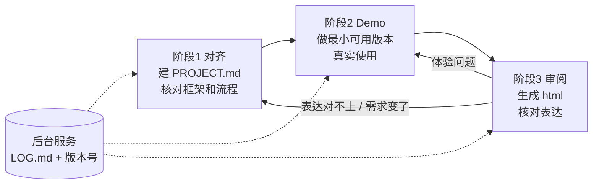

# 个人项目开发 SOP

> 一句话：三步循环推进项目——**对齐 → Demo → 审阅**；日志和版本由模型在后台维护，你只在关键处确认。

---

## 0. 总览



| 阶段 | 你做什么 | 模型做什么 | 产出 | 完成标准 |
|---|---|---|---|---|
| 1 对齐 | 回答追问，确认框架图 | 追问、起草 PROJECT.md | PROJECT.md | 你能用一句话说清做什么、不做什么，框架图你认可 |
| 2 Demo | 真实使用，口述体验 | 实现、修复、写测试 | 可运行的 demo + 测试 | 跑通主流程，体验问题都有具体例子 |
| 3 审阅 | 看 html，指出哪里不对 | 根据 md 生成 html | html 展示页 | html 表达的就是你心里想的项目 |

**后台服务（无感）**：每轮结束时，模型自动起草 LOG 节点、更新版本号，只问你一个问题确认"为什么"。

**文件结构**

```
项目/
├── SOP.md        本文件（各项目通用，不改）
├── PROJECT.md    需求 + 框架图 + 流程 + 当前状态（覆盖更新）
├── LOG.md        版本节点（只追加，后台维护）
├── showcase/     各里程碑生成的 html
├── tests/        体验问题对应的测试
└── 代码           git 管理，md 一起提交
```

---

## 后台服务：常驻规则

> 用法：放进项目根目录的 CLAUDE.md / AGENTS.md，或每次开发对话开头贴一次。整个 SOP 的"无感"靠它实现。

```
这个项目按 SOP.md 推进。请始终遵守以下规则：

【开工】
1. 先读 PROJECT.md 全文和 LOG.md 最近 3 个版本，再回答或改代码。

【记录：后台自动完成，不打断我】
2. 每完成一个功能或修复，自动按 LOG 格式起草一个版本节点（格式见 SOP.md）。
3. 版本号规则：一次集中开发 = 一个版本（v1、v2…）；方向转移的版本标题加 ⚠️。
4. 节点里的"为什么"和"否掉的方案"只记录我说过或确认过的内容。
   你推测的理由标【待确认】。
5. 起草完只问我一个问题："这轮的理由是 X，对吗？有没有放弃的方案？"
   我确认后写入 LOG.md；我没回答就保留【待确认】，不要追问第二次。

【守护】
6. 修复我在使用中发现的问题时，把我描述的具体例子写成一个测试。
7. 如果我的要求改变了项目要做的事（方向转移、需求增删），
   提醒我回到阶段 1 更新 PROJECT.md，不要自己改。
```

**LOG 节点格式**

```markdown
## vN（日期）一句话标题
### 问题
- P编号 问题描述 + 具体例子（输入什么、看到什么、哪里不对）
### 做了什么 + 效果
- [P编号] 做了什么（一句话）
  → 效果（可检验的描述，不写"变好了"）
- 否掉的方案：……（没有就不写）
### 遗留
- ……（没有就不写）
```

规则要点：问题编号跨版本连续；"做了什么"只依据对话，没明确说改完的不写成已完成；每个节点 3–5 行，写不下就拆版本。

---

## 阶段 1：对齐（建 PROJECT.md，核对框架和流程）

**什么时候进入**：新项目开始；或阶段 3 发现表达对不上、需求变了。

**提示**

```
我要开始一个新项目（或：我要调整项目定义），想法是：【一句话】

第一步：追问我，直到你能写清楚下面的内容。
一次只问一个问题，每个问题附上你推荐的答案。
- 要解决什么问题（给一个具体使用场景）
- 谁用它
- 明确不做什么
- 主要流程：用户从开始到结束经过哪几步
- 怎么算做成了

第二步：我说"可以了"之后，输出 PROJECT.md：

# 项目名
> 一句话目标
## 背景 / 要解决的问题
## 使用者
## 需求（R1、R2…编号）
## 非目标
## 主流程（编号步骤，3–7 步）
## 框架图（Mermaid，模块不超过 6 个）
## 当前状态

第三步：用三句话向我复述这个项目，让我核对你理解的和我想的是否一致。

要求：所有内容只来自我的回答，我没说过的写【待定】，不要补充。
如果是调整已有项目，只改动变化的部分，并列出改了哪些地方。
```

**完成标准**
- [ ] 第三步的三句话复述，你认为准确
- [ ] 框架图和主流程你看得懂、认可
- [ ] 【待定】都已处理，或你明确决定先放着

---

## 阶段 2：Demo 测试

**什么时候进入**：PROJECT.md 已对齐；或阶段 3 发现体验问题。

**做法**
1. 让模型实现**主流程能跑通的最小版本**，先不追求完整。
2. 你**真实使用**，不是看代码。
3. 遇到问题时，用下面的格式口述给模型：

```
体验问题：
- 我做了：【输入/操作】
- 我看到：【实际结果】
- 我期望：【应该是什么】
- 我觉得原因/想法：【可选】
```

4. 模型修复、补测试；后台服务自动记录 LOG。

**完成标准**
- [ ] 主流程完整跑通一次
- [ ] 本轮的体验问题都有具体例子，并有对应测试
- [ ] LOG.md 里本轮节点的【待确认】都已确认或你决定保留

---

## 阶段 3：生成 html 审阅（审视和对齐表达）

**什么时候进入**：一个阶段性成果完成，想回头看"项目现在到底是什么样"。

**提示**

```
根据下面的 PROJECT.md 和 LOG.md，生成一个单文件 html 展示页。

【粘贴 PROJECT.md】
【粘贴 LOG.md】

页面结构固定为：
1. 封面：项目名、一句话目标、生成日期、对应的最新版本号
2. 需求：做什么、不做什么
3. 主流程和框架图
4. 版本演进：时间线，方向转移的节点醒目标出
5. 当前效果
6. 遗留问题和否掉的方案

内容规则：
- 只能重新组织 md 里已有的内容，不得新增数据、结论或评价。
- 遗留问题和否掉的方案必须保留。
- md 里没写效果的地方，标"待验证"。

风格：简洁、浅色、卡片式，单文件，浏览器直接打开。
文件名：showcase/vN-日期.html
```

**审阅清单**（看 html 时逐条问自己）
- [ ] 一句话目标，还是我现在想做的吗？→ 不是：回阶段 1
- [ ] 主流程和框架图，和实际 demo 一致吗？→ 不一致：回阶段 1 改 PROJECT.md
- [ ] 版本演进里的"为什么"，是我当时真正的理由吗？→ 不是：改 LOG.md
- [ ] 遗留问题里，有没有现在就该做的？→ 有：回阶段 2
- [ ] 有没有 md 里没有、被模型编出来的内容？→ 有：删掉，并检查提示

**完成标准**
- [ ] 审阅清单全部过一遍，发现的问题都已分流到阶段 1 或阶段 2

---

## 附：SOP 本身的迭代

- 本 SOP 自己也用 git 管理，并配一份 LOG.md，记录每次修改的原因和效果。
- 在第一个项目上试运行两周后复盘，只问三个问题：
  1. 哪些步骤或字段从来没用上？→ 删
  2. 回忆时想找却找不到的是什么？→ 加
  3. 有多少轮跳过了记录？超过一半 → 整体简化
